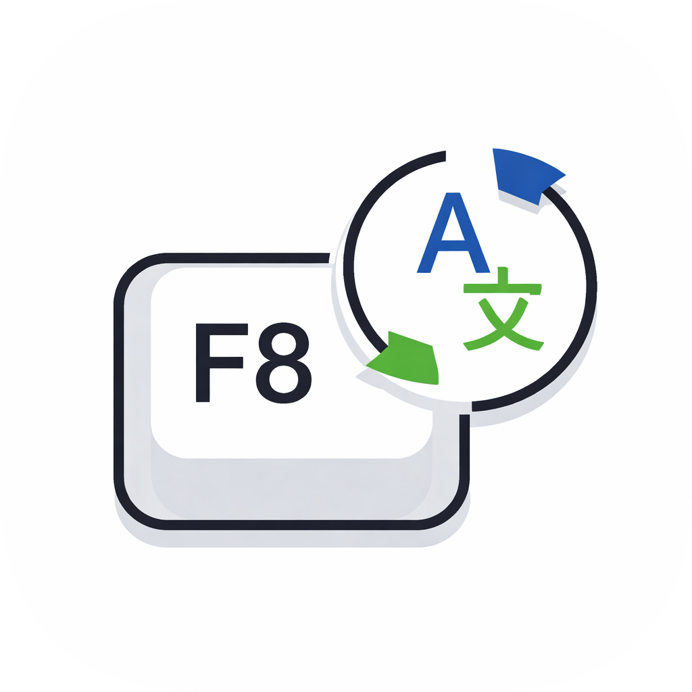

# F8 Translate

Traduza texto sem sair do seu fluxo. Aplicativo Windows em **C# / .NET 10**, com atalho global, sugestões discretas e ícone na bandeja.

## Baixar e usar — sem ambiente de desenvolvimento

Na aba **Actions → Build Windows**, abra a execução concluída com sucesso da branch `arena/91c71699-f8translate`. Em **Artifacts**, escolha:

| Download | Para quem é |
| --- | --- |
| **F8Translate-compact-win-x64** | Menor executável. Requer instalar **.NET Desktop Runtime 10 x64** uma única vez. Não precisa de SDK. |
| **F8Translate-portable-win-x64** | Runtime incluído e comprimido. Maior, mas não precisa instalar .NET. |
| **F8Translate-fontes** | Todos os fontes, documentação e configurações para editar/copiar manualmente à `main`. Não é o aplicativo pronto. |

Extraia o ZIP e abra `F8Translate.exe`. Feche a versão antiga pelo menu **Sair** na bandeja antes de abrir outra. Os tamanhos reais dos executáveis aparecem no resumo da execução do Actions.

Os downloads **expiram em 7 dias**; arquivos já baixados continuam funcionando. Você pode gerar novos downloads pelo botão **Run workflow** na branch desejada. Não há releases nem atualização automática.

## Como funciona

1. Escolha os idiomas, leia o aviso e marque **Permitir tradução online**.
2. Deixe **Sugerir tradução ao selecionar texto** marcado e clique em **Salvar e ativar**.
3. Selecione um trecho em outro aplicativo e aguarde aproximadamente um segundo.
4. Em aplicativos compatíveis, aparece um botão discreto **Traduzir seleção** perto do cursor. Ele não rouba o foco. Clique para ver a tradução.
5. Se não houver sugestão, use **F8**, ou configure outro atalho entre F6 e F12.

A observação de seleção é local, usando a acessibilidade do Windows (**UI Automation**). Não simula Ctrl+C nem envia texto ao serviço ao selecionar. **Só há envio após clique no botão ou acionamento do atalho**, com consentimento.

O idioma **não é detectado automaticamente**: o botão usa a origem/destino escolhidos. Instalações novas começam em **Inglês → Português**; configurações antigas são preservadas.

### Segundo plano

Fechar no **X** apenas esconde a janela: o aplicativo continua na bandeja. O Windows pode colocar o ícone na área `^`. Clique duas vezes para abrir, ou use o menu para **Pausar** / **Sair**. Pausar desativa atalho e observação. Não há início automático com o Windows.

### Ler ou substituir

Por padrão, o resultado aparece para leitura/cópia, sem alterar o documento. A opção de substituição automática funciona **somente com o atalho**, usando Ctrl+V, e volta desativada a cada abertura. Clicar numa sugestão nunca substitui o documento.

## Privacidade e limites

A tradução usa a API pública do **MyMemory**, sem chave, com limite de **500 bytes UTF-8 por trecho** (não 500 caracteres) e cotas próprias. Não envie senhas, dados pessoais ou confidenciais.

- O texto é enviado como parâmetro de uma requisição HTTPS, após uma ação explícita.
- O app não grava histórico de texto nem logs de conteúdo. As seleções ficam apenas transitoriamente na memória.
- O provedor tem sua própria [política de privacidade](https://mymemory.translated.net/doc/en/privacy.php) e [limites](https://mymemory.translated.net/doc/spec.php).
- Desmarcar o consentimento impede novas traduções; uma requisição já enviada não pode ser desfeita.
- Idiomas: português, inglês, espanhol, francês, alemão, italiano e japonês.
- Preferências ficam em `%LOCALAPPDATA%\F8Translate\settings.json`.

## Limitações importantes

- Exclusivo para Windows desktop. Não há OCR nem tradução de texto não selecionável.
- Sugestões dependem de o aplicativo expor uma seleção textual via UI Automation. Jogos, programas elevados, terminais, alguns PDFs e páginas podem não funcionar. Campos identificados como senha são ignorados. Desmarque as sugestões se não quiser observação local.
- Sugestões ignoram seleções vazias, múltiplas ou acima de 500 bytes. O botão desaparece após oito segundos e não reaparece para a mesma seleção até ela mudar. A detecção não é instantânea e pode demorar mais se o outro aplicativo estiver lento.
- O fallback por atalho depende de Ctrl+C; a substituição depende de Ctrl+V. Evite executar como administrador.
- Na substituição, não edite nem mude a seleção enquanto aguarda: a janela ativa é verificada, mas o app não consegue garantir que o cursor dentro dela continue no mesmo local.
- No fluxo por atalho, o clipboard é restaurado se não tiver sido modificado durante a requisição. Formatos especiais podem não ser preservados perfeitamente. Ctrl+Z depende do aplicativo de destino.
- O executável não é assinado digitalmente. Não é um instalador. A versão portátil comprimida extrai componentes temporários: baixar menos não significa usar o mesmo espaço reduzido no disco.

## Desenvolvimento e compilação

Veja o [guia para Windows](docs/DESENVOLVIMENTO.md), com instalação do SDK, comandos e roteiro de testes. Python não é necessário para usar ou compilar o aplicativo; só para o script de exportação dos fontes.

## GitHub Actions e armazenamento

- Executa em alterações de código/empacotamento ou manualmente, não em toda edição de documentação.
- Uma execução nova cancela a anterior da mesma branch; o build tem limite de dez minutos e a limpeza de dois minutos.
- Sem cache de dependências, sem tarefas periódicas e sem builds duplicados em PR.
- Pacotes de fontes e executáveis são artefatos com retenção de sete dias; não entram no histórico Git.
- Após publicar os três pacotes novos, um job isolado tenta remover os antigos deste workflow e desta branch. Não apaga artefatos de outros workflows/branches. Se faltar permissão, a limpeza avisa no Actions e a retenção continua sendo a proteção dos pacotes novos.
- A retenção não configura orçamento, não garante uso ilimitado nem limita quantas vezes alguém pode acionar o workflow. Consulte também as configurações de faturamento/limites da conta GitHub.
- O ZIP antigo foi retirado da árvore atual, mas continua no histórico; não houve reescrita do Git.

Consulte [AGENTS.md](AGENTS.md) para o fluxo de entrega. O usuário transfere os fontes manualmente para a `main`; não são criados PRs ou releases automaticamente.

## Validação

O Actions compila e publica no Windows e verifica a exportação dos fontes. Isso **não substitui testes interativos** de interface, seleção, foco e clipboard. A versão anterior funcionou no PC do usuário; a nova interface e as sugestões ainda precisam de validação manual.

## Licença

[MIT](LICENSE).
